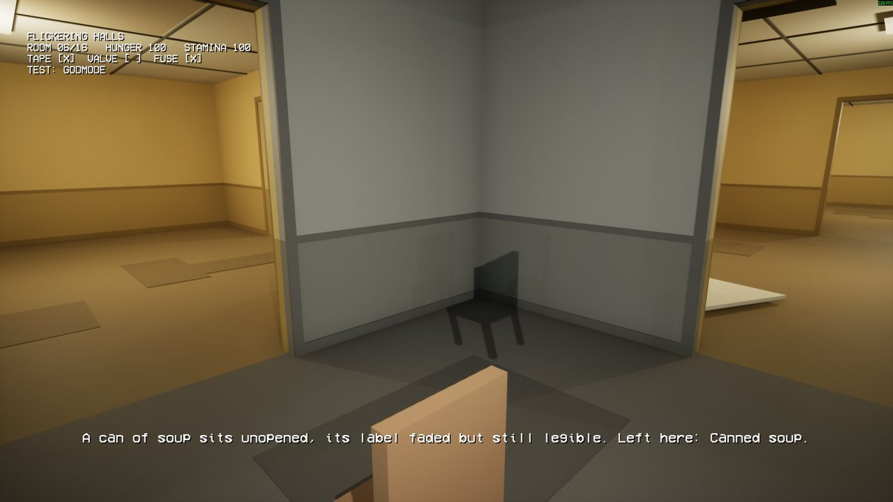

# Backrooms: Escape Together mods

A custom co-op map for [Backrooms: Escape Together](https://store.steampowered.com/app/2141730/), plus the tools that make it: a level generator that takes its lore from [The Backrooms wiki](https://backrooms-wiki.wikidot.com/), and a round trip to the Unreal editor for changing a floor by hand.

Starting Level 0 opens the elevator onto a generated floor instead: sixteen themed rooms, locked doors, three parts to find, the game's own food and drink on the tables, the game's own Skin Stealer, and an exit that does not behave.



Nothing from the game is in this repository. The floor is built at runtime from the engine's cubes, cylinders, lights and text by a [UE4SS](https://github.com/UE4SS-RE/RE-UE4SS) Lua mod. The monster and the items you pick up are the game's own, spawned from your installed copy.

## Status

| | |
| --- | --- |
| **Flickering Halls** (`the_yellow_static`) | Played in the game from the elevator to loop 2, including the Skin Stealer's kill, the inventory and the objectives panel, before the wiki level's additions to `halls.lua`. Not tried with a second player. |
| **Level 1 - "Habitable Zone"** (`level_1_habitable_zone`, the level that loads now) | Text, looks and entity from the wiki. Passes its checks without the game. Entered in the game once, for two minutes. **Not yet played to the end in the game.** |
| Version 0.3.0: no hunger or tiredness of the mod's own, nobody is moved by a trick | Passes its checks without the game. **Not yet run in the game.** |
| Unreal editor round trip | Tested against a stand-in for the editor. **Not yet run in a real Unreal editor.** |

## Install and play

1. Install the UE4SS build made for this game (from the game's Nexus Mods page) into `<game>\BET\Binaries\Win64`. Stock UE4SS does not find this game's patterns.
2. Get the mod into `<game>\BET\Binaries\Win64\ue4ss\Mods\CustomBackroomsMap`:

   ```bash
   pip install lupa
   python scripts/install_mod.py
   ```

   The game is found through Steam. If it is not, set `BET_GAME_DIR` (see `.env.example`). Without Python, copy `mod/CustomBackroomsMap` there yourself.
3. Start the game and start or load a Level 0 journey. There is nothing else to press: the elevator ride stops early and opens onto the floor.
4. Pick items up with the game's own key. They go into your real inventory; eat and drink from it as on any level.
5. **F9** tries the exit door.

Every player in a co-op game needs the same mod folder. `python scripts/package.py` makes a zip to hand over.

### Which floor loads

`mod/CustomBackroomsMap/levels/active.txt` holds one file name from that folder. Delete it to get Flickering Halls. Install again after changing it.

### How a floor plays

- Find the tape, the valve and the fuse, find the small key, pass the locked door, open the exit door, and walk the hall behind it without looking back. The game's objectives panel (Tab) shows these three goals instead of Level 0's.
- Sanity and stamina are the game's own, as on any level. The mod adds no hunger or tiredness and never makes you pass out. The Almond Water, soup and granola on the tables are the game's items and do what they do everywhere else in the game.
- Nothing in the rooms moves you. The mod only puts a player somewhere else when the elevator lets you out, in the long hall behind the exit door (that is how it stays long), and at the end of the floor.
- The Skin Stealer kills. With the lamps on it only stalks. When the lights go out (about every two to three minutes, each time a part is taken, or the game's own blackout) it comes for the nearest player. Its grab ends the run the way it does on Level 0.
- On the wiki level the lights-out is called Flickering, as on the wiki, and a room with a bed is a refuge marked by a green lamp: while every player stands in one, the Skin-Stealer is not led to them.
- The signs lie, one doorway is gone the next time you look, and something moves when nobody looks.

## Make a level from the wiki

```bash
cp .env.example .env        # then put your OpenAI key in .env; it is never committed
python generator/wiki_level.py --level level-1 --entity entity-10 --object almond_water=object-1 --activate
python generator/lore_doc.py
python scripts/dump_layout.py
python scripts/offline_check.py
python scripts/install_mod.py
```

The generator saves the wiki pages, has OpenAI pull word-for-word quotes from them, and has it write the title, looks, room descriptions and every on-screen line from those quotes, each with the quotes it rests on. Code checks the result against a definition of done (13 checks) and sends failures back until it passes. The layout, locks and item places are made and solved by code, not by OpenAI. Details: [`AGENTS.md`](AGENTS.md).

The saved lore is under [`docs/lore`](docs/lore/README.md): the wiki pages as fetched, the quoted facts, and a [lore sheet](docs/lore/level-1-habitable-zone.md) showing what each line of the map rests on.

Without the wiki: `python generator/generate_level.py --seed 1360` (add `--openai` to have room names and text rewritten).

## Change a floor by hand in the Unreal editor

```bash
python scripts/dump_layout.py                                  # what the mod builds -> unreal/layouts/<level>.layout.json
#   in the Unreal editor:  py ".../unreal/cbr_unreal.py" import ".../<level>.layout.json"
#   move, delete, add shapes, lamps and lettering
#   in the Unreal editor:  py ".../unreal/cbr_unreal.py" export ".../<level>.layout.json"
python generator/editor_layout.py level_1_habitable_zone       # -> mod/.../levels/<level>.editor.lua
python scripts/install_mod.py
```

Any UE 5 project works; nothing is cooked. Full steps and limits: [`docs/unreal-editor.md`](docs/unreal-editor.md). There is also a Blender script (`blender/build_level.py`) that builds a level's rooms as a `.glb` for looking at; it does not feed back into the mod.

## What is where

| Path | What |
| --- | --- |
| `mod/CustomBackroomsMap/` | The mod as it is installed: `Scripts/main.lua` (waits for Level 0, stops the elevator, loads the level), `Scripts/halls.lua` (builds and runs the floor), `levels/*.lua`, `levels/active.txt` |
| `levels/` | Level sources as JSON, with citations and check results; hand-made layouts as `<level>.editor.json` |
| `generator/` | `generate_level.py` (layout and solver), `update_level.py` (brings an older level file up to date), `wiki_fetch.py`, `wiki_level.py`, `wiki_dod.py` (definition of done), `text_keys.json` (every line a level can set), `lore_doc.py`, `editor_layout.py`, `settings.py` |
| `unreal/` | `cbr_unreal.py` (run in the editor), `cbr_layout.py` (formats), `layouts/` (what the mod builds, per level) |
| `docs/` | `lore/` (wiki pages, facts, lore sheets), `unreal-editor.md`, `game-index.json` (game asset names the mod refers to) |
| `scripts/` | Install, package, checks, and a test console for the running game |
| `blender/` | Blender preview of a level |

## Checks

```bash
python scripts/offline_check.py             # plays every level through halls.lua against a stand-in engine
python scripts/test_unreal_roundtrip.py     # editor import/export and the mod's side of it
python generator/wiki_dod.py levels/level_1_habitable_zone.json
node scripts/verify-no-secret.mjs           # no key in anything git would publish; .env is ignored
node scripts/verify-mod.mjs                 # the game assets the mod refers to exist in your install
node scripts/verify-install.mjs             # the installed mod is this repo's mod
```

The stand-in engine accepts every call, so these find mistakes in the mod's Lua and in level files. What the real engine does (light, collision, the Skin Stealer, the inventory) only shows in the game.

### Testing in the running game

Off unless a flag file exists in the installed mod folder, under `dev\`:

- `dev\godmode.flag`: the Skin Stealer is pushed away instead of killing you. The HUD shows `TEST: GODMODE`.
- `dev\enabled.flag`: a test console. `python scripts/live.py -e "CBR.reload({ god = true })"` reloads `halls.lua` in the running game; `python scripts/tour.py` walks the player along a route (see the top of that file).

One thing learned the hard way: in UE4SS Lua, calling `:GetFName()` on an object that is not valid crashes the game, and `pcall` does not catch it. Check `:IsValid()` first.

## Licence and credits

Code: MIT (`LICENSE`). Lore, names and descriptions from The Backrooms wiki: CC BY-SA 3.0, which also covers `docs/lore` and the wiki level's text. Details and page credits: [`NOTICE.md`](NOTICE.md). This is an unofficial mod; the game belongs to its developers.
